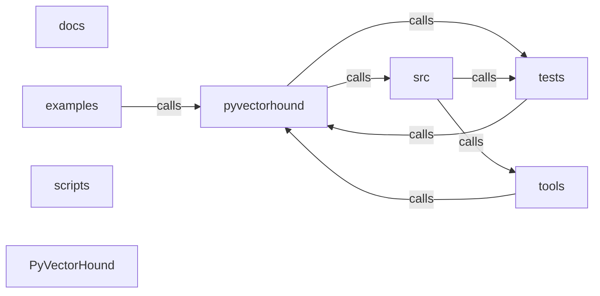

_Generated by CodeAtlas._

## Details

Architecture map of PyVectorHound.

### docs

Owns 0 symbols across 2 file(s).

**Related Classes/Methods:** _None_

### examples

Owns 10 symbols across 3 file(s).

**Related Classes/Methods:** _None_

**Source Files:**

- `examples/benchmarking_and_trends.py`
  - `examples.benchmarking_and_trends.example_performance_benchmarking`
  - `examples.benchmarking_and_trends.example_performance_benchmarking.mock_query`
  - `examples.benchmarking_and_trends.example_performance_benchmarking.query_chroma`
  - `examples.benchmarking_and_trends.example_performance_benchmarking.query_qdrant`
  - `examples.benchmarking_and_trends.example_trend_analysis`
  - `examples.benchmarking_and_trends.example_using_hound_api`
- `examples/mcp_pyvectorhound.py`
  - `examples.mcp_pyvectorhound.main`
- `examples/retrieval_debug.py`
  - `examples.retrieval_debug.InMemoryAdapter`
  - `examples.retrieval_debug.InMemoryAdapter.__init__`
  - `examples.retrieval_debug.InMemoryAdapter.get_embeddings`

### pyvectorhound

Owns 518 symbols across 31 file(s).

**Related Classes/Methods:** _None_

**Source Files:**

- `pyvectorhound/_mcp_connector.py`
  - `pyvectorhound._mcp_connector.BaseMCPConnector`
  - `pyvectorhound._mcp_connector.BaseMCPConnector.__init__`
  - `pyvectorhound._mcp_connector.BaseMCPConnector._generate_dab_config`
  - `pyvectorhound._mcp_connector.BaseMCPConnector._start_dab_subprocess`
  - `pyvectorhound._mcp_connector.BaseMCPConnector._write_temp_config`
  - `pyvectorhound._mcp_connector.BaseMCPConnector.get_mcp_tools`
  - `pyvectorhound._mcp_connector.BaseMCPConnector.get_tool_handlers`
  - `pyvectorhound._mcp_connector.BaseMCPConnector.is_ready`
  - `pyvectorhound._mcp_connector.BaseMCPConnector.start_mcp_connector`
  - `pyvectorhound._mcp_connector.BaseMCPConnector.stop_mcp_connector`
  - `pyvectorhound._mcp_connector.VectorRetrieval`
  - `pyvectorhound._mcp_connector.VectorRetrieval.__init__`
  - `pyvectorhound._mcp_connector.VectorRetrieval.start_mcp_connector`
  - `pyvectorhound._mcp_connector.VectorRetrieval.stop_mcp_connector`
  - `pyvectorhound._mcp_connector._MCPVectorConnector`
  - `pyvectorhound._mcp_connector._MCPVectorConnector.__init__`
  - `pyvectorhound._mcp_connector._MCPVectorConnector.get_mcp_tools`
  - `pyvectorhound._mcp_connector._MCPVectorConnector.get_tool_handlers`
- `pyvectorhound/_mcp_tools.py`
  - `pyvectorhound._mcp_tools.PyVectorHoundMCPHandler`
  - `pyvectorhound._mcp_tools.PyVectorHoundMCPHandler.__init__`
  - `pyvectorhound._mcp_tools.PyVectorHoundMCPHandler.batch_retrieval`
  - `pyvectorhound._mcp_tools.PyVectorHoundMCPHandler.cluster_documents`
  - `pyvectorhound._mcp_tools.PyVectorHoundMCPHandler.create_vector_index`
  - `pyvectorhound._mcp_tools.PyVectorHoundMCPHandler.delete_from_index`
  - `pyvectorhound._mcp_tools.PyVectorHoundMCPHandler.export_index`
  - `pyvectorhound._mcp_tools.PyVectorHoundMCPHandler.get_index_stats`
  - `pyvectorhound._mcp_tools.PyVectorHoundMCPHandler.hybrid_search`
  - `pyvectorhound._mcp_tools.PyVectorHoundMCPHandler.index_documents`
  - `pyvectorhound._mcp_tools.PyVectorHoundMCPHandler.rerank_results`
  - `pyvectorhound._mcp_tools.PyVectorHoundMCPHandler.retrieve_by_id`
  - `pyvectorhound._mcp_tools.PyVectorHoundMCPHandler.semantic_search`
  - `pyvectorhound._mcp_tools.PyVectorHoundMCPHandler.similarity_search`
  - `pyvectorhound._mcp_tools.PyVectorHoundMCPHandler.update_documents`
  - `pyvectorhound._mcp_tools.PyVectorHoundMCPTools`
  - `pyvectorhound._mcp_tools.PyVectorHoundMCPTools.get_tools`
- `pyvectorhound/_retry.py`
  - `pyvectorhound._retry.call_with_backoff`
- `pyvectorhound/_safe_exec.py`
  - `pyvectorhound._safe_exec.safe_execute`
  - `pyvectorhound._safe_exec.safe_execute.wrapper`
- `pyvectorhound/advanced_analytics.py`
  - `pyvectorhound.advanced_analytics.AdvancedAnalytics`
  - `pyvectorhound.advanced_analytics.AdvancedAnalytics.__init__`
  - `pyvectorhound.advanced_analytics.AdvancedAnalytics._calculate_efficiency_score`
  - `pyvectorhound.advanced_analytics.AdvancedAnalytics._find_cost_model`
  - `pyvectorhound.advanced_analytics.AdvancedAnalytics._initialize_cost_models`
  - `pyvectorhound.advanced_analytics.AdvancedAnalytics.compare_databases`
  - `pyvectorhound.advanced_analytics.AdvancedAnalytics.estimate_monthly_cost`
  - `pyvectorhound.advanced_analytics.AdvancedAnalytics.forecast_performance`
  - `pyvectorhound.advanced_analytics.AdvancedAnalytics.get_optimization_recommendations`
  - `pyvectorhound.advanced_analytics.AdvancedAnalytics.register_performance_data`
  - `pyvectorhound.advanced_analytics.CostModel`
  - `pyvectorhound.advanced_analytics.DatabaseCost`
  - `pyvectorhound.advanced_analytics.OptimizationRecommendation`
  - `pyvectorhound.advanced_analytics.PerformanceCharacteristics`
- `pyvectorhound/backends.py`
  - `pyvectorhound.backends.ChromaBackend`
  - `pyvectorhound.backends.ChromaBackend.__init__`
  - `pyvectorhound.backends.ChromaBackend.add`
  - `pyvectorhound.backends.ChromaBackend.delete`
  - `pyvectorhound.backends.ChromaBackend.get_metadata`
  - `pyvectorhound.backends.ChromaBackend.search`
  - `pyvectorhound.backends.PineconeBackend`
  - `pyvectorhound.backends.PineconeBackend.__init__`
  - `pyvectorhound.backends.PineconeBackend.add`
  - `pyvectorhound.backends.PineconeBackend.delete`
  - `pyvectorhound.backends.PineconeBackend.get_metadata`
  - `pyvectorhound.backends.PineconeBackend.search`
  - `pyvectorhound.backends.QdrantBackend`
  - `pyvectorhound.backends.QdrantBackend.__init__`
  - `pyvectorhound.backends.QdrantBackend.add`
  - `pyvectorhound.backends.QdrantBackend.delete`
  - `pyvectorhound.backends.QdrantBackend.get_metadata`
  - `pyvectorhound.backends.QdrantBackend.search`
  - `pyvectorhound.backends.VectorDBBackend`
  - `pyvectorhound.backends.VectorDBBackend.__init__`
  - `pyvectorhound.backends.VectorDBBackend.add`
  - `pyvectorhound.backends.VectorDBBackend.delete`
  - `pyvectorhound.backends.VectorDBBackend.get_metadata`
  - `pyvectorhound.backends.VectorDBBackend.search`
  - `pyvectorhound.backends.create_backend`
- `pyvectorhound/benchmarking.py`
  - `pyvectorhound.benchmarking.EmbeddingComparison`
  - `pyvectorhound.benchmarking.EmbeddingComparison.to_dict`
  - `pyvectorhound.benchmarking.LatencyMetrics`
  - `pyvectorhound.benchmarking.LatencyMetrics.to_dict`
  - `pyvectorhound.benchmarking.PerformanceBenchmark`
  - `pyvectorhound.benchmarking.PerformanceBenchmark.__init__`
  - `pyvectorhound.benchmarking.PerformanceBenchmark._compute_latency_metrics`
  - `pyvectorhound.benchmarking.PerformanceBenchmark.analyze_storage_efficiency`
  - `pyvectorhound.benchmarking.PerformanceBenchmark.capture_snapshot`
  - `pyvectorhound.benchmarking.PerformanceBenchmark.compare_databases`
  - `pyvectorhound.benchmarking.PerformanceBenchmark.compare_embedding_models`
  - `pyvectorhound.benchmarking.PerformanceBenchmark.detect_regression`
  - `pyvectorhound.benchmarking.PerformanceBenchmark.get_performance_report`
  - `pyvectorhound.benchmarking.PerformanceBenchmark.measure_embedding_latency`
  - `pyvectorhound.benchmarking.PerformanceBenchmark.measure_end_to_end_latency`
  - `pyvectorhound.benchmarking.PerformanceBenchmark.measure_query_latency`
  - `pyvectorhound.benchmarking.PerformanceSnapshot`
  - `pyvectorhound.benchmarking.PerformanceSnapshot.to_dict`
  - `pyvectorhound.benchmarking.StorageMetrics`
  - `pyvectorhound.benchmarking.StorageMetrics.to_dict`
- `pyvectorhound/cli.py`
  - `pyvectorhound.cli.CLIInterface`
  - `pyvectorhound.cli.CLIInterface.__init__`
  - `pyvectorhound.cli.CLIInterface.create_hound`
  - `pyvectorhound.cli.CLIInterface.diagnose_query`
  - `pyvectorhound.cli.CLIInterface.get_recommendations`
  - `pyvectorhound.cli.CLIInterface.list_hounds`
  - `pyvectorhound.cli.main`
  - `pyvectorhound.cli.print_help`
- `pyvectorhound/comparison.py`
  - `pyvectorhound.comparison.ModelComparison`
  - `pyvectorhound.comparison.ModelComparison.__init__`
  - `pyvectorhound.comparison.ModelComparison._benchmark_model`
  - `pyvectorhound.comparison.ModelComparison.ab_test`
  - `pyvectorhound.comparison.ModelComparison.benchmark`
  - `pyvectorhound.comparison.ModelComparison.metrics`
  - `pyvectorhound.comparison.ModelComparison.pareto_frontier`
  - `pyvectorhound.comparison.ModelComparison.report`
- `pyvectorhound/database.py`
  - `pyvectorhound.database.ChromaAdapter`
  - `pyvectorhound.database.ChromaAdapter.__init__`
  - `pyvectorhound.database.ChromaAdapter.connect`
  - `pyvectorhound.database.ChromaAdapter.corpus_size`
  - `pyvectorhound.database.ChromaAdapter.get_embeddings`
  - `pyvectorhound.database.ChromaAdapter.search`
  - `pyvectorhound.database.MilvusAdapter`
  - `pyvectorhound.database.MilvusAdapter.__init__`
  - `pyvectorhound.database.MilvusAdapter.connect`
  - `pyvectorhound.database.MilvusAdapter.corpus_size`
  - `pyvectorhound.database.MilvusAdapter.get_embeddings`
  - `pyvectorhound.database.MilvusAdapter.search`
  - `pyvectorhound.database.PostgresVectorAdapter`
  - `pyvectorhound.database.PostgresVectorAdapter.__del__`
  - `pyvectorhound.database.PostgresVectorAdapter.__init__`
  - `pyvectorhound.database.PostgresVectorAdapter.connect`
  - `pyvectorhound.database.PostgresVectorAdapter.corpus_size`
  - `pyvectorhound.database.PostgresVectorAdapter.get_embeddings`
  - `pyvectorhound.database.PostgresVectorAdapter.search`
  - `pyvectorhound.database.QdrantAdapter`
  - `pyvectorhound.database.QdrantAdapter.__init__`
  - `pyvectorhound.database.QdrantAdapter.connect`
  - `pyvectorhound.database.QdrantAdapter.corpus_size`
  - `pyvectorhound.database.QdrantAdapter.get_embeddings`
  - `pyvectorhound.database.QdrantAdapter.search`
  - `pyvectorhound.database.VectorDB`
  - `pyvectorhound.database.VectorDB.connect`
  - `pyvectorhound.database.VectorDB.corpus_size`
  - `pyvectorhound.database.VectorDB.get_embeddings`
  - `pyvectorhound.database.VectorDB.search`
  - `pyvectorhound.database.WeaviateAdapter`
  - `pyvectorhound.database.WeaviateAdapter.__init__`
  - `pyvectorhound.database.WeaviateAdapter.connect`
  - `pyvectorhound.database.WeaviateAdapter.corpus_size`
  - `pyvectorhound.database.WeaviateAdapter.get_embeddings`
  - `pyvectorhound.database.WeaviateAdapter.search`
  - `pyvectorhound.database.get_adapter`
- `pyvectorhound/db_adapters.py`
  - `pyvectorhound.db_adapters.AdapterFactory`
  - `pyvectorhound.db_adapters.AdapterFactory.create`
  - `pyvectorhound.db_adapters.AdapterFactory.get_supported_databases`
  - `pyvectorhound.db_adapters.AdapterFactory.register`
  - `pyvectorhound.db_adapters.DatabaseAdapter`
  - `pyvectorhound.db_adapters.DatabaseAdapter.__enter__`
  - `pyvectorhound.db_adapters.DatabaseAdapter.__exit__`
  - `pyvectorhound.db_adapters.DatabaseAdapter.__init__`
  - `pyvectorhound.db_adapters.DatabaseAdapter._get_index_name`
  - `pyvectorhound.db_adapters.DatabaseAdapter.connect`
  - `pyvectorhound.db_adapters.DatabaseAdapter.count_documents`
  - `pyvectorhound.db_adapters.DatabaseAdapter.create_index`
  - `pyvectorhound.db_adapters.DatabaseAdapter.delete`
  - `pyvectorhound.db_adapters.DatabaseAdapter.delete_index`
  - `pyvectorhound.db_adapters.DatabaseAdapter.disconnect`
  - `pyvectorhound.db_adapters.DatabaseAdapter.get_document`
  - `pyvectorhound.db_adapters.DatabaseAdapter.get_metrics`
  - `pyvectorhound.db_adapters.DatabaseAdapter.health_check`
  - `pyvectorhound.db_adapters.DatabaseAdapter.hybrid_search`
  - `pyvectorhound.db_adapters.DatabaseAdapter.index_exists`
  - `pyvectorhound.db_adapters.DatabaseAdapter.search`
  - `pyvectorhound.db_adapters.DatabaseAdapter.update_index_config`
  - `pyvectorhound.db_adapters.DatabaseAdapter.upsert`
  - `pyvectorhound.db_adapters.DatabaseConfig`
  - `pyvectorhound.db_adapters.DatabaseConfig.to_dict`
  - `pyvectorhound.db_adapters.DatabaseMetrics`
  - `pyvectorhound.db_adapters.DatabaseMetrics.__post_init__`
  - `pyvectorhound.db_adapters.DatabaseMetrics.to_dict`
  - `pyvectorhound.db_adapters.DatabaseType`
  - `pyvectorhound.db_adapters.MockDatabaseAdapter`
  - `pyvectorhound.db_adapters.MockDatabaseAdapter.__init__`
  - `pyvectorhound.db_adapters.MockDatabaseAdapter._matches_filters`
  - `pyvectorhound.db_adapters.MockDatabaseAdapter.connect`
  - `pyvectorhound.db_adapters.MockDatabaseAdapter.count_documents`
  - `pyvectorhound.db_adapters.MockDatabaseAdapter.create_index`
  - `pyvectorhound.db_adapters.MockDatabaseAdapter.delete`
  - `pyvectorhound.db_adapters.MockDatabaseAdapter.delete_index`
  - `pyvectorhound.db_adapters.MockDatabaseAdapter.disconnect`
  - `pyvectorhound.db_adapters.MockDatabaseAdapter.get_document`
  - `pyvectorhound.db_adapters.MockDatabaseAdapter.get_metrics`
  - `pyvectorhound.db_adapters.MockDatabaseAdapter.health_check`
  - `pyvectorhound.db_adapters.MockDatabaseAdapter.hybrid_search`
  - `pyvectorhound.db_adapters.MockDatabaseAdapter.index_exists`
  - `pyvectorhound.db_adapters.MockDatabaseAdapter.search`
  - `pyvectorhound.db_adapters.MockDatabaseAdapter.update_index_config`
  - `pyvectorhound.db_adapters.MockDatabaseAdapter.upsert`
  - `pyvectorhound.db_adapters.SearchResult`
- `pyvectorhound/diagnosis.py`
  - `pyvectorhound.diagnosis.Diagnosis`
  - `pyvectorhound.diagnosis.Diagnosis.__init__`
  - `pyvectorhound.diagnosis.Diagnosis._analyze_bm25`
  - `pyvectorhound.diagnosis.Diagnosis._analyze_embedding`
  - `pyvectorhound.diagnosis.Diagnosis._analyze_faithfulness`
  - `pyvectorhound.diagnosis.Diagnosis._analyze_reranker`
  - `pyvectorhound.diagnosis.Diagnosis._analyze_vector_search`
  - `pyvectorhound.diagnosis.Diagnosis._classify`
  - `pyvectorhound.diagnosis.Diagnosis._compute_mrr`
  - `pyvectorhound.diagnosis.Diagnosis.analyze`
  - `pyvectorhound.diagnosis.Diagnosis.hunt`
  - `pyvectorhound.diagnosis.Diagnosis.metrics`
  - `pyvectorhound.diagnosis.Diagnosis.recommendations`
  - `pyvectorhound.diagnosis.Diagnosis.root_cause`
  - `pyvectorhound.diagnosis.Diagnosis.summary`
  - `pyvectorhound.diagnosis.DiagnosisResult`
  - `pyvectorhound.diagnosis._status_from_baseline`
  - `pyvectorhound.diagnosis._status_from_threshold`
- `pyvectorhound/error_messages.py`
  - `pyvectorhound.error_messages.DiagnosticError`
  - `pyvectorhound.error_messages.DiagnosticError.__init__`
  - `pyvectorhound.error_messages.DiagnosticError.__str__`
  - `pyvectorhound.error_messages.DiagnosticError.format`
  - `pyvectorhound.error_messages.get_connection_error`
  - `pyvectorhound.error_messages.get_similarity_error`
- `pyvectorhound/errors.py`
  - `pyvectorhound.errors.EmbeddingError`
  - `pyvectorhound.errors.VectorDatabaseError`
  - `pyvectorhound.errors.VectorDiagnosticError`
  - `pyvectorhound.errors.VectorDiagnosticError.__init__`
  - `pyvectorhound.errors.VectorDiagnosticError.get_internal_message`
  - `pyvectorhound.errors.VectorDiagnosticError.get_user_message`
  - `pyvectorhound.errors.safe_database_error`
  - `pyvectorhound.errors.safe_embedding_error`
- `pyvectorhound/hound.py`
  - `pyvectorhound.hound.Hound`
  - `pyvectorhound.hound.Hound.__init__`
  - `pyvectorhound.hound.Hound.analyze_trends`
  - `pyvectorhound.hound.Hound.benchmark`
  - `pyvectorhound.hound.Hound.compare_metrics`
  - `pyvectorhound.hound.Hound.compare_models`
  - `pyvectorhound.hound.Hound.detect_drift`
  - `pyvectorhound.hound.Hound.diagnose`
  - `pyvectorhound.hound.Hound.diagnose_batch`
  - `pyvectorhound.hound.Hound.get_performance_report`
  - `pyvectorhound.hound.Hound.get_recommendation_summary`
  - `pyvectorhound.hound.Hound.get_recommendations`
  - `pyvectorhound.hound.Hound.get_trend_report`
  - `pyvectorhound.hound.Hound.measure_query_latency`
  - `pyvectorhound.hound.Hound.quality_scorer`
  - `pyvectorhound.hound.Hound.replayer`
  - `pyvectorhound.hound.Hound.tracer`
  - `pyvectorhound.hound.Hound.track_metric`
- `pyvectorhound/langchain_integration.py`
  - `pyvectorhound.langchain_integration.DiagnosticRetrievalQA`
  - `pyvectorhound.langchain_integration.DiagnosticRetrievalQA.__call__`
  - `pyvectorhound.langchain_integration.DiagnosticRetrievalQA.__init__`
  - `pyvectorhound.langchain_integration.DiagnosticRetrievalQA.invoke`
  - `pyvectorhound.langchain_integration.InstrumentedRetriever`
  - `pyvectorhound.langchain_integration.InstrumentedRetriever.__getattr__`
  - `pyvectorhound.langchain_integration.InstrumentedRetriever.__init__`
  - `pyvectorhound.langchain_integration.InstrumentedRetriever.aget_relevant_documents`
  - `pyvectorhound.langchain_integration.InstrumentedRetriever.get_relevant_documents`
  - `pyvectorhound.langchain_integration.LangChainTracingConfig`
  - `pyvectorhound.langchain_integration.PyVectorHoundCallbackHandler`
  - `pyvectorhound.langchain_integration.PyVectorHoundCallbackHandler.__init__`
  - `pyvectorhound.langchain_integration.PyVectorHoundCallbackHandler._extract_embedding_model`
  - `pyvectorhound.langchain_integration.PyVectorHoundCallbackHandler._run_auto_diagnosis`
  - `pyvectorhound.langchain_integration.PyVectorHoundCallbackHandler.on_llm_end`
  - `pyvectorhound.langchain_integration.PyVectorHoundCallbackHandler.on_llm_start`
  - `pyvectorhound.langchain_integration.PyVectorHoundCallbackHandler.on_retriever_end`
  - `pyvectorhound.langchain_integration.PyVectorHoundCallbackHandler.on_retriever_start`
  - `pyvectorhound.langchain_integration.create_diagnostic_qa_chain`
  - `pyvectorhound.langchain_integration.instrument_langchain_chain`
- `pyvectorhound/llamaindex_integration.py`
  - `pyvectorhound.llamaindex_integration.DiagnosticNodePostprocessor`
  - `pyvectorhound.llamaindex_integration.DiagnosticNodePostprocessor.__call__`
  - `pyvectorhound.llamaindex_integration.DiagnosticNodePostprocessor.__init__`
  - `pyvectorhound.llamaindex_integration.DiagnosticNodePostprocessor._postprocess_nodes`
  - `pyvectorhound.llamaindex_integration.DiagnosticNodePostprocessor.postprocess_nodes`
  - `pyvectorhound.llamaindex_integration.DiagnosticQueryEngine`
  - `pyvectorhound.llamaindex_integration.DiagnosticQueryEngine.__getattr__`
  - `pyvectorhound.llamaindex_integration.DiagnosticQueryEngine.__init__`
  - `pyvectorhound.llamaindex_integration.DiagnosticQueryEngine.aquery`
  - `pyvectorhound.llamaindex_integration.DiagnosticQueryEngine.query`
  - `pyvectorhound.llamaindex_integration.DiagnosticVectorIndexRetriever`
  - `pyvectorhound.llamaindex_integration.DiagnosticVectorIndexRetriever.__getattr__`
  - `pyvectorhound.llamaindex_integration.DiagnosticVectorIndexRetriever.__init__`
  - `pyvectorhound.llamaindex_integration.DiagnosticVectorIndexRetriever.aretrieve`
  - `pyvectorhound.llamaindex_integration.DiagnosticVectorIndexRetriever.retrieve`
  - `pyvectorhound.llamaindex_integration.LlamaIndexTracingConfig`
  - `pyvectorhound.llamaindex_integration.PyVectorHoundInstrumentationCallback`
  - `pyvectorhound.llamaindex_integration.PyVectorHoundInstrumentationCallback.__init__`
  - `pyvectorhound.llamaindex_integration.PyVectorHoundInstrumentationCallback._extract_embedding_model`
  - `pyvectorhound.llamaindex_integration.PyVectorHoundInstrumentationCallback._run_auto_diagnosis`
  - `pyvectorhound.llamaindex_integration.PyVectorHoundInstrumentationCallback.on_retrieve_end`
  - `pyvectorhound.llamaindex_integration.PyVectorHoundInstrumentationCallback.on_retrieve_start`
  - `pyvectorhound.llamaindex_integration.PyVectorHoundInstrumentationCallback.on_synthesize_end`
  - `pyvectorhound.llamaindex_integration.PyVectorHoundInstrumentationCallback.on_synthesize_start`
  - `pyvectorhound.llamaindex_integration.instrument_llamaindex_engine`
  - `pyvectorhound.llamaindex_integration.instrument_llamaindex_retriever`
- `pyvectorhound/logging_config.py`
  - `pyvectorhound.logging_config.configure_logging`
  - `pyvectorhound.logging_config.get_logger`
- `pyvectorhound/okf_diagnostics.py`
  - `pyvectorhound.okf_diagnostics.OKFDiagnosticDocument`
  - `pyvectorhound.okf_diagnostics.OKFDiagnosticDocument.__init__`
  - `pyvectorhound.okf_diagnostics.OKFDiagnosticDocument.confidence`
  - `pyvectorhound.okf_diagnostics.OKFDiagnosticDocument.failure_types`
  - `pyvectorhound.okf_diagnostics.OKFDiagnosticDocument.get_metadata`
  - `pyvectorhound.okf_diagnostics.OKFDiagnosticDocument.query_id`
  - `pyvectorhound.okf_diagnostics.OKFDiagnosticDocument.recommendations`
  - `pyvectorhound.okf_diagnostics.OKFDiagnosticDocument.root_cause`
  - `pyvectorhound.okf_diagnostics.OKFDiagnosticKnowledgeBase`
  - `pyvectorhound.okf_diagnostics.OKFDiagnosticKnowledgeBase.__init__`
  - `pyvectorhound.okf_diagnostics.OKFDiagnosticKnowledgeBase._ensure_structure`
  - `pyvectorhound.okf_diagnostics.OKFDiagnosticKnowledgeBase._load_all`
  - `pyvectorhound.okf_diagnostics.OKFDiagnosticKnowledgeBase.extract_patterns`
  - `pyvectorhound.okf_diagnostics.OKFDiagnosticKnowledgeBase.find_similar_failures`
  - `pyvectorhound.okf_diagnostics.OKFDiagnosticKnowledgeBase.generate_enhanced_recommendations`
  - `pyvectorhound.okf_diagnostics.OKFDiagnosticKnowledgeBase.get_playbook`
  - `pyvectorhound.okf_diagnostics.OKFDiagnosticKnowledgeBase.get_success_rate_for_strategy`
  - `pyvectorhound.okf_diagnostics.OKFDiagnosticKnowledgeBase.record_diagnosis`
  - `pyvectorhound.okf_diagnostics.OKFDiagnosticKnowledgeBase.reload`
- `pyvectorhound/otel_integration.py`
  - `pyvectorhound.otel_integration.LoggingExporter`
  - `pyvectorhound.otel_integration.LoggingExporter.export_metric`
  - `pyvectorhound.otel_integration.LoggingExporter.export_span`
  - `pyvectorhound.otel_integration.Metric`
  - `pyvectorhound.otel_integration.Metric.__init__`
  - `pyvectorhound.otel_integration.Metric.to_dict`
  - `pyvectorhound.otel_integration.OTelBackend`
  - `pyvectorhound.otel_integration.OTelConfig`
  - `pyvectorhound.otel_integration.OTelConfig.to_dict`
  - `pyvectorhound.otel_integration.OTelExporter`
  - `pyvectorhound.otel_integration.OTelExporter.__init__`
  - `pyvectorhound.otel_integration.OTelExporter.export_metric`
  - `pyvectorhound.otel_integration.OTelExporter.export_span`
  - `pyvectorhound.otel_integration.OTelExporter.flush`
  - `pyvectorhound.otel_integration.OTelInstrument`
  - `pyvectorhound.otel_integration.OTelInstrument.__init__`
  - `pyvectorhound.otel_integration.OTelInstrument._create_exporter`
  - `pyvectorhound.otel_integration.OTelInstrument.flush`
  - `pyvectorhound.otel_integration.OTelInstrument.get_stats`
  - `pyvectorhound.otel_integration.OTelInstrument.get_trace_context`
  - `pyvectorhound.otel_integration.OTelInstrument.record_metric`
  - `pyvectorhound.otel_integration.OTelInstrument.record_replay_metrics`
  - `pyvectorhound.otel_integration.OTelInstrument.record_span`
  - `pyvectorhound.otel_integration.OTelInstrument.record_trace_metrics`
  - `pyvectorhound.otel_integration.OTelInstrument.set_trace_context`
  - `pyvectorhound.otel_integration.OTelInstrument.start_span`
  - `pyvectorhound.otel_integration.PrometheusExporter`
  - `pyvectorhound.otel_integration.PrometheusExporter.__init__`
  - `pyvectorhound.otel_integration.PrometheusExporter.export_metric`
  - `pyvectorhound.otel_integration.PrometheusExporter.get_prometheus_format`
  - `pyvectorhound.otel_integration.TraceSpan`
  - `pyvectorhound.otel_integration.TraceSpan.__init__`
  - `pyvectorhound.otel_integration.TraceSpan.add_event`
  - `pyvectorhound.otel_integration.TraceSpan.duration_ms`
  - `pyvectorhound.otel_integration.TraceSpan.end`
  - `pyvectorhound.otel_integration.TraceSpan.set_attribute`
  - `pyvectorhound.otel_integration.TraceSpan.set_status`
  - `pyvectorhound.otel_integration.TraceSpan.to_dict`
- `pyvectorhound/ranking.py`
  - `pyvectorhound.ranking._require_core`
  - `pyvectorhound.ranking.compute_reranker_metrics`
  - `pyvectorhound.ranking.rank_and_diversify`
- `pyvectorhound/recommendations.py`
  - `pyvectorhound.recommendations.DiagnosticReport`
  - `pyvectorhound.recommendations.DiagnosticReport.to_dict`
  - `pyvectorhound.recommendations.FailureCategory`
  - `pyvectorhound.recommendations.FixRecommendation`
  - `pyvectorhound.recommendations.FixRecommendation.roi`
  - `pyvectorhound.recommendations.FixRecommendation.to_dict`
  - `pyvectorhound.recommendations.RecommendationEngine`
  - `pyvectorhound.recommendations.RecommendationEngine.__init__`
  - `pyvectorhound.recommendations.RecommendationEngine._calculate_confidence`
  - `pyvectorhound.recommendations.RecommendationEngine._generate_chunking_fixes`
  - `pyvectorhound.recommendations.RecommendationEngine._generate_embedding_fixes`
  - `pyvectorhound.recommendations.RecommendationEngine._generate_filtering_fixes`
  - `pyvectorhound.recommendations.RecommendationEngine._generate_fixes_for_failure`
  - `pyvectorhound.recommendations.RecommendationEngine._generate_next_steps`
  - `pyvectorhound.recommendations.RecommendationEngine._generate_reranking_fixes`
  - `pyvectorhound.recommendations.RecommendationEngine._generate_summary`
  - `pyvectorhound.recommendations.RecommendationEngine._generate_vector_search_fixes`
  - `pyvectorhound.recommendations.RecommendationEngine._identify_primary_failures`
  - `pyvectorhound.recommendations.RecommendationEngine._initialize_fix_templates`
  - `pyvectorhound.recommendations.RecommendationEngine.analyze_failure`
  - `pyvectorhound.recommendations.RecommendationEngine.estimate_roi`
  - `pyvectorhound.recommendations.RecommendationEngine.get_recommendation_summary`
- `pyvectorhound/retrieval_replay.py`
  - `pyvectorhound.retrieval_replay.ComponentType`
  - `pyvectorhound.retrieval_replay.ReplayComparison`
  - `pyvectorhound.retrieval_replay.ReplayComparison.to_dict`
  - `pyvectorhound.retrieval_replay.ReplayConfiguration`
  - `pyvectorhound.retrieval_replay.ReplayConfiguration.to_dict`
  - `pyvectorhound.retrieval_replay.ReplayResult`
  - `pyvectorhound.retrieval_replay.ReplayResult.to_dict`
  - `pyvectorhound.retrieval_replay.RetrievalReplayer`
  - `pyvectorhound.retrieval_replay.RetrievalReplayer.__init__`
  - `pyvectorhound.retrieval_replay.RetrievalReplayer._compute_mrr`
  - `pyvectorhound.retrieval_replay.RetrievalReplayer._compute_ndcg`
  - `pyvectorhound.retrieval_replay.RetrievalReplayer._compute_precision_at_k`
  - `pyvectorhound.retrieval_replay.RetrievalReplayer._compute_recall_at_k`
  - `pyvectorhound.retrieval_replay.RetrievalReplayer._generate_recommendation`
  - `pyvectorhound.retrieval_replay.RetrievalReplayer.compare_configurations`
  - `pyvectorhound.retrieval_replay.RetrievalReplayer.create_configuration`
  - `pyvectorhound.retrieval_replay.RetrievalReplayer.get_all_results`
  - `pyvectorhound.retrieval_replay.RetrievalReplayer.get_configuration_report`
  - `pyvectorhound.retrieval_replay.RetrievalReplayer.get_result`
  - `pyvectorhound.retrieval_replay.RetrievalReplayer.rank_configurations_by_efficiency`
  - `pyvectorhound.retrieval_replay.RetrievalReplayer.rank_configurations_by_efficiency.efficiency_score`
  - `pyvectorhound.retrieval_replay.RetrievalReplayer.rank_configurations_by_latency`
  - `pyvectorhound.retrieval_replay.RetrievalReplayer.rank_configurations_by_recall`
  - `pyvectorhound.retrieval_replay.RetrievalReplayer.register_component_handler`
  - `pyvectorhound.retrieval_replay.RetrievalReplayer.replay`
- `pyvectorhound/retrieval_tracing.py`
  - `pyvectorhound.retrieval_tracing.PhaseMetrics`
  - `pyvectorhound.retrieval_tracing.PhaseMetrics.to_dict`
  - `pyvectorhound.retrieval_tracing.RetrievalTrace`
  - `pyvectorhound.retrieval_tracing.RetrievalTrace.to_dict`
  - `pyvectorhound.retrieval_tracing.RetrievalTracer`
  - `pyvectorhound.retrieval_tracing.RetrievalTracer.__init__`
  - `pyvectorhound.retrieval_tracing.RetrievalTracer.clear_traces`
  - `pyvectorhound.retrieval_tracing.RetrievalTracer.end_phase`
  - `pyvectorhound.retrieval_tracing.RetrievalTracer.end_trace`
  - `pyvectorhound.retrieval_tracing.RetrievalTracer.export_all_traces`
  - `pyvectorhound.retrieval_tracing.RetrievalTracer.export_trace`
  - `pyvectorhound.retrieval_tracing.RetrievalTracer.get_all_traces`
  - `pyvectorhound.retrieval_tracing.RetrievalTracer.get_statistics`
  - `pyvectorhound.retrieval_tracing.RetrievalTracer.get_trace`
  - `pyvectorhound.retrieval_tracing.RetrievalTracer.get_trace_analysis`
  - `pyvectorhound.retrieval_tracing.RetrievalTracer.record_bm25_results`
  - `pyvectorhound.retrieval_tracing.RetrievalTracer.record_context_assembly`
  - `pyvectorhound.retrieval_tracing.RetrievalTracer.record_embedding`
  - `pyvectorhound.retrieval_tracing.RetrievalTracer.record_filtered_results`
  - `pyvectorhound.retrieval_tracing.RetrievalTracer.record_llm_response`
  - `pyvectorhound.retrieval_tracing.RetrievalTracer.record_metadata`
  - `pyvectorhound.retrieval_tracing.RetrievalTracer.record_reranked_results`
  - `pyvectorhound.retrieval_tracing.RetrievalTracer.record_vector_search_results`
  - `pyvectorhound.retrieval_tracing.RetrievalTracer.start_phase`
  - `pyvectorhound.retrieval_tracing.RetrievalTracer.start_trace`
  - `pyvectorhound.retrieval_tracing.SearchResult`
  - `pyvectorhound.retrieval_tracing.SearchResult.to_dict`
  - `pyvectorhound.retrieval_tracing.TracePhase`
- `pyvectorhound/scorer.py`
  - `pyvectorhound.scorer.QualityScorer`
  - `pyvectorhound.scorer.QualityScorer.__init__`
  - `pyvectorhound.scorer.QualityScorer._classify`
  - `pyvectorhound.scorer.QualityScorer.corpus_health`
  - `pyvectorhound.scorer.QualityScorer.detect_anomalies`
  - `pyvectorhound.scorer.QualityScorer.score`
  - `pyvectorhound.scorer.QualityScorer.trend_analysis`
- `pyvectorhound/server.py`
  - `pyvectorhound.server.PyvectorhoundServer`
  - `pyvectorhound.server.PyvectorhoundServer.__init__`
  - `pyvectorhound.server.PyvectorhoundServer.create_hound`
  - `pyvectorhound.server.PyvectorhoundServer.diagnose_query`
  - `pyvectorhound.server.PyvectorhoundServer.get_recommendations`
  - `pyvectorhound.server.PyvectorhoundServer.health_check`
  - `pyvectorhound.server.PyvectorhoundServer.list_hounds`
  - `pyvectorhound.server.create_flask_app`
  - `pyvectorhound.server.create_flask_app.create_hound`
  - `pyvectorhound.server.create_flask_app.diagnose`
  - `pyvectorhound.server.create_flask_app.health`
  - `pyvectorhound.server.create_flask_app.list_hounds`
  - `pyvectorhound.server.create_flask_app.recommendations`
  - `pyvectorhound.server.run_server`
- `pyvectorhound/trend_analysis.py`
  - `pyvectorhound.trend_analysis.AnomalyDetection`
  - `pyvectorhound.trend_analysis.AnomalyDetection.to_dict`
  - `pyvectorhound.trend_analysis.DriftAnalysis`
  - `pyvectorhound.trend_analysis.DriftAnalysis.to_dict`
  - `pyvectorhound.trend_analysis.RegressionAnalysis`
  - `pyvectorhound.trend_analysis.RegressionAnalysis.to_dict`
  - `pyvectorhound.trend_analysis.TimeSeries`
  - `pyvectorhound.trend_analysis.TimeSeries.__init__`
  - `pyvectorhound.trend_analysis.TimeSeries.add_point`
  - `pyvectorhound.trend_analysis.TimeSeries.get_points`
  - `pyvectorhound.trend_analysis.TimeSeries.get_values`
  - `pyvectorhound.trend_analysis.TimeSeries.mean`
  - `pyvectorhound.trend_analysis.TimeSeries.stddev`
  - `pyvectorhound.trend_analysis.TimeSeries.trend_direction`
  - `pyvectorhound.trend_analysis.TrendAnalyzer`
  - `pyvectorhound.trend_analysis.TrendAnalyzer.__init__`
  - `pyvectorhound.trend_analysis.TrendAnalyzer._classify_anomaly`
  - `pyvectorhound.trend_analysis.TrendAnalyzer.detect_anomalies`
  - `pyvectorhound.trend_analysis.TrendAnalyzer.detect_drift`
  - `pyvectorhound.trend_analysis.TrendAnalyzer.detect_regression`
  - `pyvectorhound.trend_analysis.TrendAnalyzer.get_historical_comparison`
  - `pyvectorhound.trend_analysis.TrendAnalyzer.get_metric_series`
  - `pyvectorhound.trend_analysis.TrendAnalyzer.get_trend_report`
  - `pyvectorhound.trend_analysis.TrendAnalyzer.set_baseline`
  - `pyvectorhound.trend_analysis.TrendAnalyzer.track_metric`
  - `pyvectorhound.trend_analysis.TrendPoint`
  - `pyvectorhound.trend_analysis.TrendPoint.to_dict`
- `pyvectorhound/validation.py`
  - `pyvectorhound.validation.DiagnosisParams`
  - `pyvectorhound.validation.DiagnosisParams.validate_query`
  - `pyvectorhound.validation.EmbeddingQuery`
  - `pyvectorhound.validation.EmbeddingQuery.validate_text`
  - `pyvectorhound.validation.RerankerQuery`
  - `pyvectorhound.validation.RerankerQuery.validate_candidates`
  - `pyvectorhound.validation.VectorSearchQuery`
  - `pyvectorhound.validation.VectorSearchQuery.validate_vector`
  - `pyvectorhound.validation.validate_embedding_vector`
  - `pyvectorhound.validation.validate_query_object`
- `pyvectorhound/web_dashboard.py`
  - `pyvectorhound.web_dashboard.Dashboard`
  - `pyvectorhound.web_dashboard.Dashboard.__init__`
  - `pyvectorhound.web_dashboard.Dashboard._get_dashboard_html`
  - `pyvectorhound.web_dashboard.Dashboard.create_app`
  - `pyvectorhound.web_dashboard.Dashboard.create_app.get_db_comparison`
  - `pyvectorhound.web_dashboard.Dashboard.create_app.get_performance`
  - `pyvectorhound.web_dashboard.Dashboard.create_app.get_recommendations`
  - `pyvectorhound.web_dashboard.Dashboard.create_app.get_replays`
  - `pyvectorhound.web_dashboard.Dashboard.create_app.get_summary`
  - `pyvectorhound.web_dashboard.Dashboard.create_app.get_traces`
  - `pyvectorhound.web_dashboard.Dashboard.create_app.health`
  - `pyvectorhound.web_dashboard.Dashboard.create_app.root`
  - `pyvectorhound.web_dashboard.Dashboard.get_app`
  - `pyvectorhound.web_dashboard.Dashboard.run`
  - `pyvectorhound.web_dashboard.DashboardConfig`
  - `pyvectorhound.web_dashboard.DashboardMetrics`
  - `pyvectorhound.web_dashboard.DashboardMetrics.__init__`
  - `pyvectorhound.web_dashboard.DashboardMetrics._calculate_avg_latency`
  - `pyvectorhound.web_dashboard.DashboardMetrics._calculate_avg_recall`
  - `pyvectorhound.web_dashboard.DashboardMetrics.add_analytics_report`
  - `pyvectorhound.web_dashboard.DashboardMetrics.add_recommendation`
  - `pyvectorhound.web_dashboard.DashboardMetrics.add_replay_result`
  - `pyvectorhound.web_dashboard.DashboardMetrics.add_trace_metric`
  - `pyvectorhound.web_dashboard.DashboardMetrics.add_trend_data`
  - `pyvectorhound.web_dashboard.DashboardMetrics.clear_old_data`
  - `pyvectorhound.web_dashboard.DashboardMetrics.clear_old_data.is_recent`
  - `pyvectorhound.web_dashboard.DashboardMetrics.get_database_comparison_data`
  - `pyvectorhound.web_dashboard.DashboardMetrics.get_performance_chart_data`
  - `pyvectorhound.web_dashboard.DashboardMetrics.get_recommendations_summary`
  - `pyvectorhound.web_dashboard.DashboardMetrics.get_summary`

### scripts

Owns 0 symbols across 1 file(s).

**Related Classes/Methods:** _None_

### src

Owns 62 symbols across 4 file(s).

**Related Classes/Methods:** _None_

**Source Files:**

- `src/lib.rs`
  - `src.lib._core`
  - `src.lib.params_to_dict`
  - `src.lib.py_compute_coverage`
  - `src.lib.py_compute_distinctiveness`
  - `src.lib.py_compute_isotropy`
  - `src.lib.py_compute_quality_score`
  - `src.lib.py_compute_reranker_metrics`
  - `src.lib.py_compute_retrieval_metrics`
  - `src.lib.py_dequantize_batch`
  - `src.lib.py_dequantize_vector`
  - `src.lib.py_detect_drift`
  - `src.lib.py_quantize_batch`
  - `src.lib.py_quantize_vector`
  - `src.lib.py_rank_and_diversify_results`
  - `src.lib.ranked_results_to_pylist`
- `src/metrics.rs`
  - `src.metrics.RetrievalMetrics`
  - `src.metrics.compute_coverage`
  - `src.metrics.compute_distinctiveness`
  - `src.metrics.compute_isotropy`
  - `src.metrics.compute_retrieval_metrics`
  - `src.metrics.detect_drift`
  - `src.metrics.tests.test_coverage`
  - `src.metrics.tests.test_isotropy`
  - `src.metrics.tests.test_retrieval_metrics`
- `src/quantization.rs`
  - `src.quantization.QuantizationParams`
  - `src.quantization.dequantize`
  - `src.quantization.dequantize_batch`
  - `src.quantization.quantize`
  - `src.quantization.quantize_batch`
  - `src.quantization.tests.max_abs_error`
  - `src.quantization.tests.pseudo_random_floats`
  - `src.quantization.tests.test_all_zero_vector_is_exact`
  - `src.quantization.tests.test_empty_vector`
  - `src.quantization.tests.test_extremes_map_to_i8_bounds`
  - `src.quantization.tests.test_memory_footprint_is_4x_smaller`
  - `src.quantization.tests.test_quantize_batch_round_trip`
  - `src.quantization.tests.test_round_trip_unit_range`
  - `src.quantization.tests.test_round_trip_wide_range`
  - `src.quantization.tests.test_round_trip_zero_to_one_range`
  - `src.quantization.tests.test_single_element_vector`
  - `src.quantization.tests.test_single_value_constant_vector_is_exact`
- `src/retrieval_ranking.rs`
  - `src.retrieval_ranking.RankedResult`
  - `src.retrieval_ranking.RerankerMetrics`
  - `src.retrieval_ranking.RerankerMetrics._calculate_diversity_score`
  - `src.retrieval_ranking.RerankerMetrics._calculate_mrr`
  - `src.retrieval_ranking.RerankerMetrics._calculate_ndcg`
  - `src.retrieval_ranking.RerankerMetrics.calculate`
  - `src.retrieval_ranking.RetrievalRanker`
  - `src.retrieval_ranking.RetrievalRanker._calculate_multi_criteria_score`
  - `src.retrieval_ranking.RetrievalRanker._calculate_similarity_penalty`
  - `src.retrieval_ranking.RetrievalRanker.diversify`
  - `src.retrieval_ranking.RetrievalRanker.new`
  - `src.retrieval_ranking.RetrievalRanker.rank`
  - `src.retrieval_ranking.RetrievalResult`
  - `src.retrieval_ranking.cosine_similarity`
  - `src.retrieval_ranking.tests.test_cosine_similarity`
  - `src.retrieval_ranking.tests.test_diversification`
  - `src.retrieval_ranking.tests.test_diversification_output_is_sorted_by_adjusted_score_not_selection_order`
  - `src.retrieval_ranking.tests.test_diversification_penalizes_near_duplicate_embeddings`
  - `src.retrieval_ranking.tests.test_metrics_calculation`
  - `src.retrieval_ranking.tests.test_ranker_creation`
  - `src.retrieval_ranking.tests.test_ranking`

### tests

Owns 292 symbols across 12 file(s).

**Related Classes/Methods:** _None_

**Source Files:**

- `tests/test_benchmarking.py`
  - `tests.test_benchmarking.TestEmbeddingComparison`
  - `tests.test_benchmarking.TestEmbeddingComparison.test_embedding_comparison_creation`
  - `tests.test_benchmarking.TestLatencyMetrics`
  - `tests.test_benchmarking.TestLatencyMetrics.test_latency_metrics_creation`
  - `tests.test_benchmarking.TestLatencyMetrics.test_latency_metrics_to_dict`
  - `tests.test_benchmarking.TestPerformanceBenchmark`
  - `tests.test_benchmarking.TestPerformanceBenchmark.test_benchmark_initialization`
  - `tests.test_benchmarking.TestPerformanceBenchmark.test_capture_snapshot`
  - `tests.test_benchmarking.TestPerformanceBenchmark.test_compare_databases`
  - `tests.test_benchmarking.TestPerformanceBenchmark.test_compare_databases.query_chroma`
  - `tests.test_benchmarking.TestPerformanceBenchmark.test_compare_databases.query_qdrant`
  - `tests.test_benchmarking.TestPerformanceBenchmark.test_compare_embedding_models`
  - `tests.test_benchmarking.TestPerformanceBenchmark.test_compute_latency_metrics`
  - `tests.test_benchmarking.TestPerformanceBenchmark.test_detect_regression`
  - `tests.test_benchmarking.TestPerformanceBenchmark.test_empty_latencies`
  - `tests.test_benchmarking.TestPerformanceBenchmark.test_get_performance_report`
  - `tests.test_benchmarking.TestPerformanceBenchmark.test_measure_embedding_latency`
  - `tests.test_benchmarking.TestPerformanceBenchmark.test_measure_embedding_latency.mock_embedding_fn`
  - `tests.test_benchmarking.TestPerformanceBenchmark.test_measure_end_to_end_latency`
  - `tests.test_benchmarking.TestPerformanceBenchmark.test_measure_end_to_end_latency.mock_e2e`
  - `tests.test_benchmarking.TestPerformanceBenchmark.test_measure_query_latency`
  - `tests.test_benchmarking.TestPerformanceBenchmark.test_measure_query_latency.mock_query`
  - `tests.test_benchmarking.TestPerformanceSnapshot`
  - `tests.test_benchmarking.TestPerformanceSnapshot.test_snapshot_creation`
  - `tests.test_benchmarking.TestPerformanceSnapshot.test_snapshot_to_dict`
  - `tests.test_benchmarking.TestStorageMetrics`
  - `tests.test_benchmarking.TestStorageMetrics.test_storage_metrics_creation`
- `tests/test_codeatlas_adapter.py`
  - `tests.test_codeatlas_adapter._run`
  - `tests.test_codeatlas_adapter.test_check_reports_the_embedded_engine_available`
  - `tests.test_codeatlas_adapter.test_diagnose_summarises_the_architecture_map`
  - `tests.test_codeatlas_adapter.test_explain_reports_an_unknown_node_as_an_error`
  - `tests.test_codeatlas_adapter.test_god_nodes_are_ranked_by_degree`
- `tests/test_database_adapters.py`
  - `tests.test_database_adapters.FakeChromaCollection`
  - `tests.test_database_adapters.FakeChromaCollection.__init__`
  - `tests.test_database_adapters.FakeChromaCollection.count`
  - `tests.test_database_adapters.FakeChromaCollection.get`
  - `tests.test_database_adapters.FakeChromaCollection.query`
  - `tests.test_database_adapters.FakeMilvusClient`
  - `tests.test_database_adapters.FakeMilvusClient.__init__`
  - `tests.test_database_adapters.FakeMilvusClient.get`
  - `tests.test_database_adapters.FakeMilvusClient.get_collection_stats`
  - `tests.test_database_adapters.FakeMilvusClient.search`
  - `tests.test_database_adapters.FakeQdrantClient`
  - `tests.test_database_adapters.FakeQdrantClient.__init__`
  - `tests.test_database_adapters.FakeQdrantClient.retrieve`
  - `tests.test_database_adapters.FakeQdrantClient.search`
  - `tests.test_database_adapters.FakeQdrantPoint`
  - `tests.test_database_adapters.FakeQdrantPoint.__init__`
  - `tests.test_database_adapters.FakeQdrantResult`
  - `tests.test_database_adapters.FakeQdrantResult.__init__`
  - `tests.test_database_adapters.TestChromaAdapter`
  - `tests.test_database_adapters.TestChromaAdapter.test_corpus_size_matches_collection_count`
  - `tests.test_database_adapters.TestChromaAdapter.test_get_embeddings_returns_real_vectors`
  - `tests.test_database_adapters.TestMilvusAdapter`
  - `tests.test_database_adapters.TestMilvusAdapter.test_connect_without_pymilvus_installed_raises_actionable_import_error`
  - `tests.test_database_adapters.TestMilvusAdapter.test_corpus_size_reflects_real_collection_stats`
  - `tests.test_database_adapters.TestMilvusAdapter.test_get_adapter_factory_returns_milvus_adapter`
  - `tests.test_database_adapters.TestMilvusAdapter.test_get_embeddings_empty_input_returns_empty_without_querying`
  - `tests.test_database_adapters.TestMilvusAdapter.test_get_embeddings_returns_real_vectors_for_requested_ids`
  - `tests.test_database_adapters.TestMilvusAdapter.test_get_embeddings_skips_unknown_ids_instead_of_fabricating_data`
  - `tests.test_database_adapters.TestMilvusAdapter.test_get_embeddings_uses_configured_vector_field_name`
  - `tests.test_database_adapters.TestMilvusAdapter.test_get_embeddings_uses_configured_vector_field_name.RenamedFieldClient`
  - `tests.test_database_adapters.TestMilvusAdapter.test_get_embeddings_uses_configured_vector_field_name.RenamedFieldClient.get`
  - `tests.test_database_adapters.TestMilvusAdapter.test_search_maps_id_and_score_from_client_results`
  - `tests.test_database_adapters.TestQdrantAdapter`
  - `tests.test_database_adapters.TestQdrantAdapter.test_get_embeddings_returns_real_vectors`
- `tests/test_diagnosis.py`
  - `tests.test_diagnosis.FakeEmbeddingAdapter`
  - `tests.test_diagnosis.FakeEmbeddingAdapter.__init__`
  - `tests.test_diagnosis.FakeEmbeddingAdapter.get_embeddings`
  - `tests.test_diagnosis.TestDiagnosis`
  - `tests.test_diagnosis.TestDiagnosis.test_hunt_report`
  - `tests.test_diagnosis.TestDiagnosis.test_init`
  - `tests.test_diagnosis.TestDiagnosis.test_metrics`
  - `tests.test_diagnosis.TestDiagnosis.test_recommendations`
  - `tests.test_diagnosis.TestDiagnosis.test_root_cause`
  - `tests.test_diagnosis.TestDiagnosis.test_with_expected_docs`
  - `tests.test_diagnosis.TestDynamicThresholdCalibration`
  - `tests.test_diagnosis.TestDynamicThresholdCalibration.test_falls_back_to_fixed_cutoff_without_trend_analyzer`
  - `tests.test_diagnosis.TestDynamicThresholdCalibration.test_uses_baseline_when_trend_analyzer_has_one`
  - `tests.test_diagnosis.TestDynamicThresholdCalibration.test_uses_tracked_series_as_baseline_without_explicit_set_baseline`
  - `tests.test_diagnosis.TestEmbeddingAnalysis`
  - `tests.test_diagnosis.TestEmbeddingAnalysis.test_reports_unknown_with_fewer_than_two_embeddings`
  - `tests.test_diagnosis.TestEmbeddingAnalysis.test_reports_unknown_without_adapter`
  - `tests.test_diagnosis.TestEmbeddingAnalysis.test_uses_real_embeddings_not_hardcoded_placeholders`
  - `tests.test_diagnosis.TestFaithfulnessAnalysis`
  - `tests.test_diagnosis.TestFaithfulnessAnalysis.test_calls_llm_judge_fn_with_query_and_retrieved_texts`
  - `tests.test_diagnosis.TestFaithfulnessAnalysis.test_calls_llm_judge_fn_with_query_and_retrieved_texts.judge`
  - `tests.test_diagnosis.TestFaithfulnessAnalysis.test_flags_contradicted_documents_as_weak`
  - `tests.test_diagnosis.TestFaithfulnessAnalysis.test_flags_contradicted_documents_as_weak.judge`
  - `tests.test_diagnosis.TestFaithfulnessAnalysis.test_llm_judge_fn_retries_on_transient_failure`
  - `tests.test_diagnosis.TestFaithfulnessAnalysis.test_llm_judge_fn_retries_on_transient_failure.flaky_judge`
  - `tests.test_diagnosis.TestFaithfulnessAnalysis.test_reports_unknown_with_judge_fn_but_no_texts`
  - `tests.test_diagnosis.TestFaithfulnessAnalysis.test_reports_unknown_without_llm_judge_fn_or_document_texts`
  - `tests.test_diagnosis.TestFaithfulnessAnalysis.test_root_cause_surfaces_contradiction_over_embedding_score`
  - `tests.test_diagnosis.TestFaithfulnessAnalysis.test_root_cause_surfaces_contradiction_over_embedding_score.judge`
  - `tests.test_diagnosis.TestUnimplementedComponentsReportHonestly`
  - `tests.test_diagnosis.TestUnimplementedComponentsReportHonestly.test_bm25_reports_unknown_not_fake_good`
  - `tests.test_diagnosis.TestUnimplementedComponentsReportHonestly.test_reranker_reports_unknown_not_fake_good`
  - `tests.test_diagnosis.TestUnimplementedComponentsReportHonestly.test_root_cause_does_not_blame_bm25_when_unmeasured`
  - `tests.test_diagnosis.TestVectorSearchMRR`
  - `tests.test_diagnosis.TestVectorSearchMRR.test_mrr_is_half_when_relevant_result_is_second`
  - `tests.test_diagnosis.TestVectorSearchMRR.test_mrr_is_one_when_first_result_is_relevant`
  - `tests.test_diagnosis.TestVectorSearchMRR.test_mrr_is_zero_when_nothing_relevant_retrieved`
- `tests/test_hound.py`
  - `tests.test_hound.TestDiagnoseBatch`
  - `tests.test_hound.TestDiagnoseBatch._hound_with_fake_adapter`
  - `tests.test_hound.TestDiagnoseBatch._hound_with_fake_adapter.FakeAdapter`
  - `tests.test_hound.TestDiagnoseBatch._hound_with_fake_adapter.FakeAdapter.__init__`
  - `tests.test_hound.TestDiagnoseBatch._hound_with_fake_adapter.FakeAdapter.get_embeddings`
  - `tests.test_hound.TestDiagnoseBatch._hound_with_fake_adapter.FakeAdapter.search`
  - `tests.test_hound.TestDiagnoseBatch.test_mismatched_list_lengths_raise`
  - `tests.test_hound.TestDiagnoseBatch.test_one_failing_query_does_not_lose_others_result`
  - `tests.test_hound.TestDiagnoseBatch.test_returns_diagnosis_per_query_in_order`
  - `tests.test_hound.TestDiagnoseBatch.test_runs_queries_concurrently_not_serially`
  - `tests.test_hound.TestDiagnosis`
  - `tests.test_hound.TestDiagnosis.test_diagnosis_hunt`
  - `tests.test_hound.TestHound`
  - `tests.test_hound.TestHound.test_diagnose`
  - `tests.test_hound.TestHound.test_diagnose.FakeAdapter`
  - `tests.test_hound.TestHound.test_diagnose.FakeAdapter.__init__`
  - `tests.test_hound.TestHound.test_diagnose.FakeAdapter.get_embeddings`
  - `tests.test_hound.TestHound.test_diagnose.FakeAdapter.search`
  - `tests.test_hound.TestHound.test_diagnose_uses_embed_fn_when_no_embedding_given`
  - `tests.test_hound.TestHound.test_diagnose_uses_embed_fn_when_no_embedding_given.RecordingAdapter`
  - `tests.test_hound.TestHound.test_diagnose_uses_embed_fn_when_no_embedding_given.RecordingAdapter.__init__`
  - `tests.test_hound.TestHound.test_diagnose_uses_embed_fn_when_no_embedding_given.RecordingAdapter.search`
  - `tests.test_hound.TestHound.test_diagnose_uses_embed_fn_when_no_embedding_given.fake_embed`
  - `tests.test_hound.TestHound.test_diagnose_without_embedding_or_embed_fn_raises`
  - `tests.test_hound.TestHound.test_diagnose_without_embedding_or_embed_fn_raises.RecordingAdapter`
  - `tests.test_hound.TestHound.test_diagnose_without_embedding_or_embed_fn_raises.RecordingAdapter.__init__`
  - `tests.test_hound.TestHound.test_diagnose_without_embedding_or_embed_fn_raises.RecordingAdapter.search`
  - `tests.test_hound.TestHound.test_init_chroma`
  - `tests.test_hound.TestHound.test_init_qdrant`
  - `tests.test_hound.TestHound.test_quality_scorer`
  - `tests.test_hound.TestHound.test_unsupported_db`
- `tests/test_okf_diagnostics.py`
  - `tests.test_okf_diagnostics.TestOKFDiagnosticDocumentLoading`
  - `tests.test_okf_diagnostics.TestOKFDiagnosticDocumentLoading.test_document_metadata`
  - `tests.test_okf_diagnostics.TestOKFDiagnosticDocumentLoading.test_document_recommendations`
  - `tests.test_okf_diagnostics.TestOKFDiagnosticDocumentLoading.test_load_diagnostic_document`
  - `tests.test_okf_diagnostics.TestOKFDiagnosticKBOperations`
  - `tests.test_okf_diagnostics.TestOKFDiagnosticKBOperations.test_find_nonexistent_pattern`
  - `tests.test_okf_diagnostics.TestOKFDiagnosticKBOperations.test_find_similar_failures`
  - `tests.test_okf_diagnostics.TestOKFDiagnosticKBOperations.test_find_similar_with_limit`
  - `tests.test_okf_diagnostics.TestOKFDiagnosticKBOperations.test_kb_directory_structure`
  - `tests.test_okf_diagnostics.TestOKFDiagnosticKBOperations.test_record_diagnosis`
  - `tests.test_okf_diagnostics.TestOKFPatternExtraction`
  - `tests.test_okf_diagnostics.TestOKFPatternExtraction.test_extract_patterns`
  - `tests.test_okf_diagnostics.TestOKFPatternExtraction.test_min_frequency_filtering`
  - `tests.test_okf_diagnostics.TestOKFPatternExtraction.test_pattern_frequency`
  - `tests.test_okf_diagnostics.TestOKFPatternExtraction.test_pattern_success_rate`
  - `tests.test_okf_diagnostics.TestOKFRecommendationEnhancement`
  - `tests.test_okf_diagnostics.TestOKFRecommendationEnhancement.test_enhance_recommendations`
  - `tests.test_okf_diagnostics.TestOKFRecommendationEnhancement.test_recommendations_sorted_by_success`
  - `tests.test_okf_diagnostics.TestOKFReload`
  - `tests.test_okf_diagnostics.TestOKFReload.test_reload_syncs_index`
  - `tests.test_okf_diagnostics.TestOKFStrategySuccess`
  - `tests.test_okf_diagnostics.TestOKFStrategySuccess.test_get_success_rate`
  - `tests.test_okf_diagnostics.TestOKFStrategySuccess.test_nonexistent_strategy_rate`
  - `tests.test_okf_diagnostics.TestOKFStrategySuccess.test_success_rate_averaging`
  - `tests.test_okf_diagnostics.populated_kb`
  - `tests.test_okf_diagnostics.temp_kb`
- `tests/test_ranking.py`
  - `tests.test_ranking.test_compute_reranker_metrics_against_ground_truth`
  - `tests.test_ranking.test_documents_without_embeddings_get_no_penalty`
  - `tests.test_ranking.test_mismatched_lengths_raises`
  - `tests.test_ranking.test_near_duplicate_embedding_is_penalized_more_than_distinct_one`
  - `tests.test_ranking.test_output_order_reflects_diversity_adjusted_score_not_selection_order`
  - `tests.test_ranking.test_top_k_truncates_after_ranking`
- `tests/test_recommendations.py`
  - `tests.test_recommendations.TestDiagnosticReport`
  - `tests.test_recommendations.TestDiagnosticReport.test_create_report`
  - `tests.test_recommendations.TestDiagnosticReport.test_report_to_dict`
  - `tests.test_recommendations.TestFixRecommendation`
  - `tests.test_recommendations.TestFixRecommendation.test_create_recommendation`
  - `tests.test_recommendations.TestFixRecommendation.test_recommendation_roi`
  - `tests.test_recommendations.TestFixRecommendation.test_recommendation_to_dict`
  - `tests.test_recommendations.TestRecommendationEngine`
  - `tests.test_recommendations.TestRecommendationEngine.test_analyze_failure_chunking`
  - `tests.test_recommendations.TestRecommendationEngine.test_analyze_failure_embedding`
  - `tests.test_recommendations.TestRecommendationEngine.test_analyze_failure_metadata_filtering`
  - `tests.test_recommendations.TestRecommendationEngine.test_calculate_confidence`
  - `tests.test_recommendations.TestRecommendationEngine.test_engine_initialization`
  - `tests.test_recommendations.TestRecommendationEngine.test_estimate_roi`
  - `tests.test_recommendations.TestRecommendationEngine.test_full_analysis_workflow`
  - `tests.test_recommendations.TestRecommendationEngine.test_generate_chunking_fixes`
  - `tests.test_recommendations.TestRecommendationEngine.test_generate_embedding_fixes`
  - `tests.test_recommendations.TestRecommendationEngine.test_generate_next_steps`
  - `tests.test_recommendations.TestRecommendationEngine.test_generate_summary`
  - `tests.test_recommendations.TestRecommendationEngine.test_get_recommendation_summary`
  - `tests.test_recommendations.TestRecommendationEngine.test_identify_primary_failures`
- `tests/test_retrieval_replay.py`
  - `tests.test_retrieval_replay.TestReplayConfiguration`
  - `tests.test_retrieval_replay.TestReplayConfiguration.test_configuration_to_dict`
  - `tests.test_retrieval_replay.TestReplayConfiguration.test_create_configuration`
  - `tests.test_retrieval_replay.TestReplayResult`
  - `tests.test_retrieval_replay.TestReplayResult.test_result_creation`
  - `tests.test_retrieval_replay.TestRetrievalReplayer`
  - `tests.test_retrieval_replay.TestRetrievalReplayer.test_compare_configurations`
  - `tests.test_retrieval_replay.TestRetrievalReplayer.test_compare_configurations.dummy_handler`
  - `tests.test_retrieval_replay.TestRetrievalReplayer.test_compute_mrr`
  - `tests.test_retrieval_replay.TestRetrievalReplayer.test_compute_ndcg`
  - `tests.test_retrieval_replay.TestRetrievalReplayer.test_compute_recall_at_k`
  - `tests.test_retrieval_replay.TestRetrievalReplayer.test_create_configuration`
  - `tests.test_retrieval_replay.TestRetrievalReplayer.test_generate_recommendation`
  - `tests.test_retrieval_replay.TestRetrievalReplayer.test_get_configuration_report`
  - `tests.test_retrieval_replay.TestRetrievalReplayer.test_rank_configurations_by_efficiency`
  - `tests.test_retrieval_replay.TestRetrievalReplayer.test_rank_configurations_by_latency`
  - `tests.test_retrieval_replay.TestRetrievalReplayer.test_rank_configurations_by_recall`
  - `tests.test_retrieval_replay.TestRetrievalReplayer.test_replay`
  - `tests.test_retrieval_replay.TestRetrievalReplayer.test_replay.dummy_handler`
  - `tests.test_retrieval_replay.TestRetrievalReplayer.test_replayer_initialization`
- `tests/test_scorer.py`
  - `tests.test_scorer.FakeAdapter`
  - `tests.test_scorer.FakeAdapter.__init__`
  - `tests.test_scorer.FakeAdapter.corpus_size`
  - `tests.test_scorer.FakeAdapter.get_embeddings`
  - `tests.test_scorer.FakeAdapter.search`
  - `tests.test_scorer.TestQualityScorerAnomalyDetection`
  - `tests.test_scorer.TestQualityScorerAnomalyDetection.test_detects_outlier_by_magnitude`
  - `tests.test_scorer.TestQualityScorerCorpusHealth`
  - `tests.test_scorer.TestQualityScorerCorpusHealth.test_corpus_health_uses_real_sampled_embeddings`
  - `tests.test_scorer.TestQualityScorerCorpusHealth.test_corpus_health_without_adapter_is_honest`
  - `tests.test_scorer.TestQualityScorerDynamicCalibration`
  - `tests.test_scorer.TestQualityScorerDynamicCalibration.test_falls_back_to_fixed_cutoff_without_trend_analyzer`
  - `tests.test_scorer.TestQualityScorerDynamicCalibration.test_uses_baseline_when_trend_analyzer_has_one`
  - `tests.test_scorer.TestQualityScorerScore`
  - `tests.test_scorer.TestQualityScorerScore.test_score_with_adapter_uses_real_neighbor_embeddings`
  - `tests.test_scorer.TestQualityScorerScore.test_score_without_adapter_is_honestly_unknown_not_fake_good`
  - `tests.test_scorer.TestQualityScorerTrendAnalysis`
  - `tests.test_scorer.TestQualityScorerTrendAnalysis.test_trend_analysis_is_honest_about_not_tracking_history`
- `tests/test_trend_analysis.py`
  - `tests.test_trend_analysis.TestAnomalyDetection`
  - `tests.test_trend_analysis.TestAnomalyDetection.test_anomaly_detection_creation`
  - `tests.test_trend_analysis.TestDriftAnalysis`
  - `tests.test_trend_analysis.TestDriftAnalysis.test_drift_analysis_creation`
  - `tests.test_trend_analysis.TestRegressionAnalysis`
  - `tests.test_trend_analysis.TestRegressionAnalysis.test_regression_analysis_creation`
  - `tests.test_trend_analysis.TestTimeSeries`
  - `tests.test_trend_analysis.TestTimeSeries.test_add_multiple_points`
  - `tests.test_trend_analysis.TestTimeSeries.test_add_point`
  - `tests.test_trend_analysis.TestTimeSeries.test_get_values`
  - `tests.test_trend_analysis.TestTimeSeries.test_get_values_with_time_filter`
  - `tests.test_trend_analysis.TestTimeSeries.test_mean`
  - `tests.test_trend_analysis.TestTimeSeries.test_stddev`
  - `tests.test_trend_analysis.TestTimeSeries.test_timeseries_creation`
  - `tests.test_trend_analysis.TestTimeSeries.test_trend_direction_down`
  - `tests.test_trend_analysis.TestTimeSeries.test_trend_direction_stable`
  - `tests.test_trend_analysis.TestTimeSeries.test_trend_direction_up`
  - `tests.test_trend_analysis.TestTrendAnalyzer`
  - `tests.test_trend_analysis.TestTrendAnalyzer.test_analyzer_initialization`
  - `tests.test_trend_analysis.TestTrendAnalyzer.test_anomaly_classification_drop`
  - `tests.test_trend_analysis.TestTrendAnalyzer.test_anomaly_classification_spike`
  - `tests.test_trend_analysis.TestTrendAnalyzer.test_detect_anomalies`
  - `tests.test_trend_analysis.TestTrendAnalyzer.test_detect_drift`
  - `tests.test_trend_analysis.TestTrendAnalyzer.test_detect_drift_no_baseline`
  - `tests.test_trend_analysis.TestTrendAnalyzer.test_detect_drift_no_metric`
  - `tests.test_trend_analysis.TestTrendAnalyzer.test_detect_regression`
  - `tests.test_trend_analysis.TestTrendAnalyzer.test_get_historical_comparison`
  - `tests.test_trend_analysis.TestTrendAnalyzer.test_get_metric_series`
  - `tests.test_trend_analysis.TestTrendAnalyzer.test_get_metric_series_nonexistent`
  - `tests.test_trend_analysis.TestTrendAnalyzer.test_get_trend_report`
  - `tests.test_trend_analysis.TestTrendAnalyzer.test_get_trend_report_specific_metrics`
  - `tests.test_trend_analysis.TestTrendAnalyzer.test_integration_tracking_and_analysis`
  - `tests.test_trend_analysis.TestTrendAnalyzer.test_set_baseline`
  - `tests.test_trend_analysis.TestTrendAnalyzer.test_track_metric`
  - `tests.test_trend_analysis.TestTrendAnalyzer.test_track_multiple_metrics`
  - `tests.test_trend_analysis.TestTrendPoint`
  - `tests.test_trend_analysis.TestTrendPoint.test_trend_point_creation`
  - `tests.test_trend_analysis.TestTrendPoint.test_trend_point_to_dict`
  - `tests.test_trend_analysis.TestTrendPoint.test_trend_point_with_tags`
- `tests/test_v05_integrations.py`
  - `tests.test_v05_integrations.TestAdvancedAnalytics`
  - `tests.test_v05_integrations.TestAdvancedAnalytics.test_analytics_initialization`
  - `tests.test_v05_integrations.TestAdvancedAnalytics.test_cost_estimation`
  - `tests.test_v05_integrations.TestAdvancedAnalytics.test_database_comparison`
  - `tests.test_v05_integrations.TestAdvancedAnalytics.test_register_performance_data`
  - `tests.test_v05_integrations.TestDatabaseAdapters`
  - `tests.test_v05_integrations.TestDatabaseAdapters.test_adapter_factory`
  - `tests.test_v05_integrations.TestDatabaseAdapters.test_database_config`
  - `tests.test_v05_integrations.TestDatabaseAdapters.test_mock_adapter_creation`
  - `tests.test_v05_integrations.TestDatabaseAdapters.test_mock_adapter_operations`
  - `tests.test_v05_integrations.TestIntegration`
  - `tests.test_v05_integrations.TestIntegration.test_analytics_workflow`
  - `tests.test_v05_integrations.TestIntegration.test_full_workflow_mock_adapter`
  - `tests.test_v05_integrations.TestLangChainIntegration`
  - `tests.test_v05_integrations.TestLangChainIntegration.test_callback_handler_creation`
  - `tests.test_v05_integrations.TestLangChainIntegration.test_instrumented_retriever_creation`
  - `tests.test_v05_integrations.TestLangChainIntegration.test_instrumented_retriever_creation.MockRetriever`
  - `tests.test_v05_integrations.TestLangChainIntegration.test_instrumented_retriever_creation.MockRetriever.get_relevant_documents`
  - `tests.test_v05_integrations.TestLlamaIndexIntegration`
  - `tests.test_v05_integrations.TestLlamaIndexIntegration.test_callback_creation`
  - `tests.test_v05_integrations.TestLlamaIndexIntegration.test_diagnostic_retriever_creation`
  - `tests.test_v05_integrations.TestLlamaIndexIntegration.test_diagnostic_retriever_creation.MockRetriever`
  - `tests.test_v05_integrations.TestLlamaIndexIntegration.test_diagnostic_retriever_creation.MockRetriever.retrieve`
  - `tests.test_v05_integrations.TestOpenTelemetry`
  - `tests.test_v05_integrations.TestOpenTelemetry.test_metric`
  - `tests.test_v05_integrations.TestOpenTelemetry.test_otel_config`
  - `tests.test_v05_integrations.TestOpenTelemetry.test_otel_instrument`
  - `tests.test_v05_integrations.TestOpenTelemetry.test_trace_span`

### tools

Owns 0 symbols across 0 file(s).

**Related Classes/Methods:** _None_

### PyVectorHound

Owns 0 symbols across 20 file(s).

**Related Classes/Methods:** _None_
